<p align="center">
  
</p>

<h1 align="center">权益雷达 <sub>Benefit Radar</sub></h1>

<p align="center">
  从官方政策里，找到与你有关的支持。<br>
  看懂条件，准备材料，把值得办的事一件件办好。
</p>

<p align="center">
  
  
  
  
</p>

<p align="center">
  <a href="https://47.120.19.14/">在线体验</a> ·
  <a href="#体验流程">体验流程</a> ·
  <a href="#快速开始">快速开始</a> ·
  <a href="#账号与-api-配置">账号与 API</a> ·
  <a href="#元宝搜索参与在哪里">元宝搜索</a> ·
  <a href="#验证记录">验证记录</a>
</p>

---

政策公告告诉你发生了什么，申请时还需要知道：**与我有没有关系，要准备什么，接下来去哪办。**

权益雷达把这些步骤放在同一个工作区：先根据已核验的官方资料核对条件，再把材料、办理入口、申请进度和后续变化留在一起。当前为 **天津试点**，内置三项政策，提供默认本地模式与可选账号模式；账号之间独立保存清单、问答与元宝搜索配置。尚未实现全国政策查询。

**[在线账户版](https://47.120.19.14/)** 已部署。注册或登录后进入独立工作区；联网检索需配置你自己的元宝 SearchPro Key，未配置时仍可核对已整理资料，不会转用管理员的 Key。

<p align="center">
  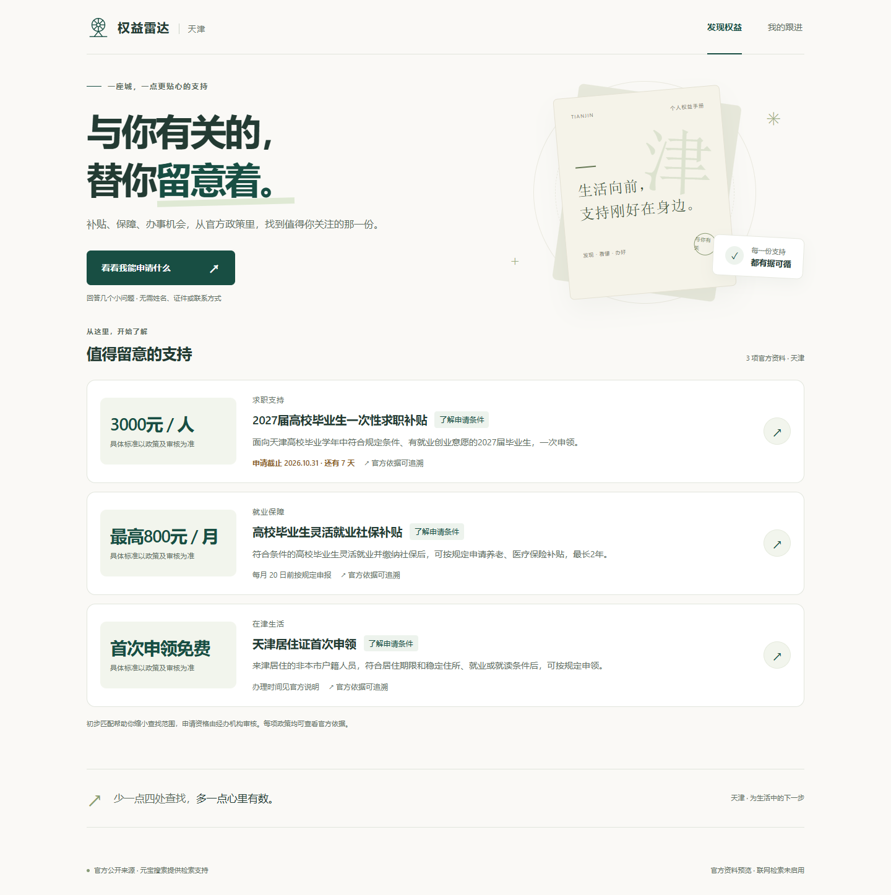
</p>

<p align="center"><sub>实际应用界面 · 桌面与手机共用一套流程</sub></p>

## 体验流程

**了解情况 → 核对条件 → 准备材料 → 跟进申请 → 留意变化。** 每一步都有可查看的官方依据，暂不确定的回答可以保留，填错的条件可以修改。

<table>
  <tr>
    <td width="50%" valign="top">
      <strong>01 / 简单了解你的情况</strong><br>
      <sub>选择当前阶段、毕业年份与院校情况，无需姓名、证件或联系方式。</sub><br><br>
      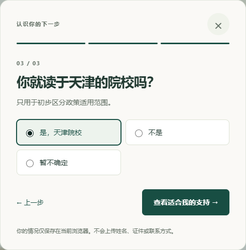
    </td>
    <td width="50%" valign="top">
      <strong>02 / 逐项核对，保留不确定</strong><br>
      <sub>进入一项政策后再确认具体条件，已有回答随时可以纠正。</sub><br><br>
      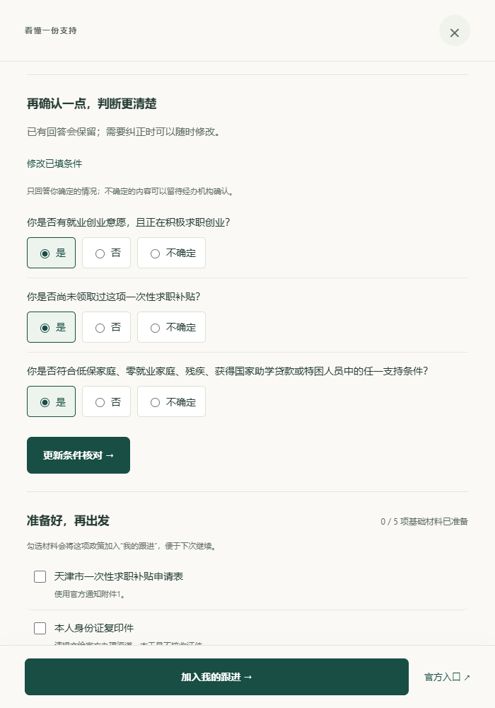
    </td>
  </tr>
  <tr>
    <td width="50%" valign="top">
      <strong>03 / 看清与你的关系</strong><br>
      <sub>区分可能适用、待补信息、当前不适用与已截止，并说明判断依据。</sub><br><br>
      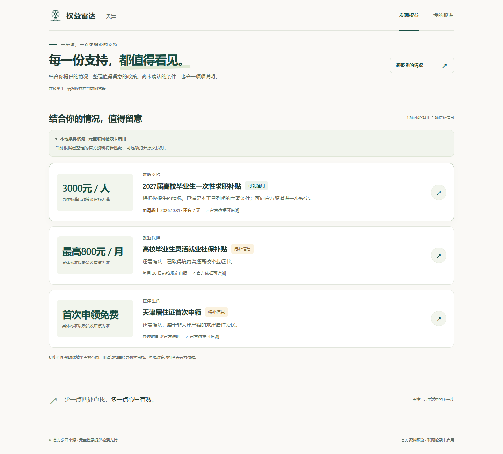
    </td>
    <td width="50%" valign="top">
      <strong>04 / 把材料准备到位</strong><br>
      <sub>基础必备与按情形补充分开，进度只统计基础材料，支持导出 Markdown 清单。</sub><br><br>
      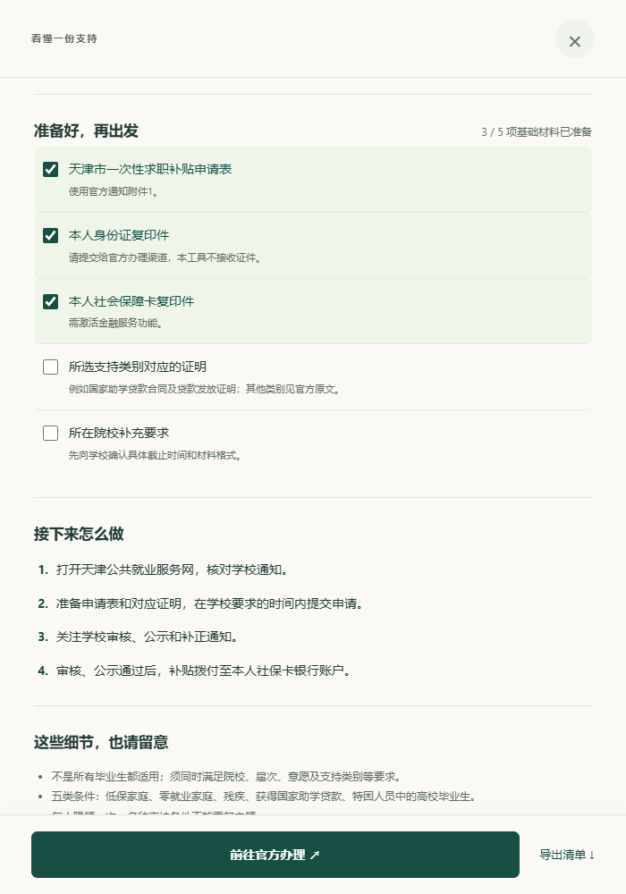
    </td>
  </tr>
  <tr>
    <td width="50%" valign="top">
      <strong>05 / 下一次，从这里继续</strong><br>
      <sub>跟进卡直接说明下一步，定位待核对条件、缺少材料或办理进展；申请状态与材料进度独立保存。</sub><br><br>
      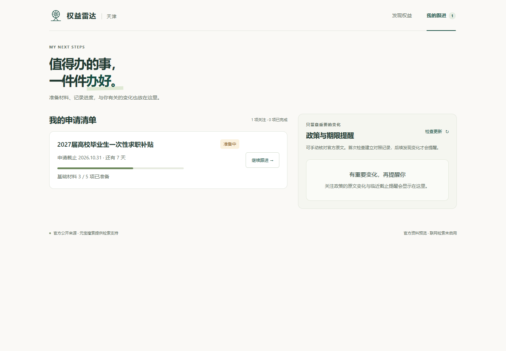
    </td>
    <td width="50%" valign="top">
      <strong>06 / 变化出现时，有迹可查</strong><br>
      <sub>检查关注政策的官方原文，展示检查状态；发现变化后提示重新核对。</sub><br><br>
      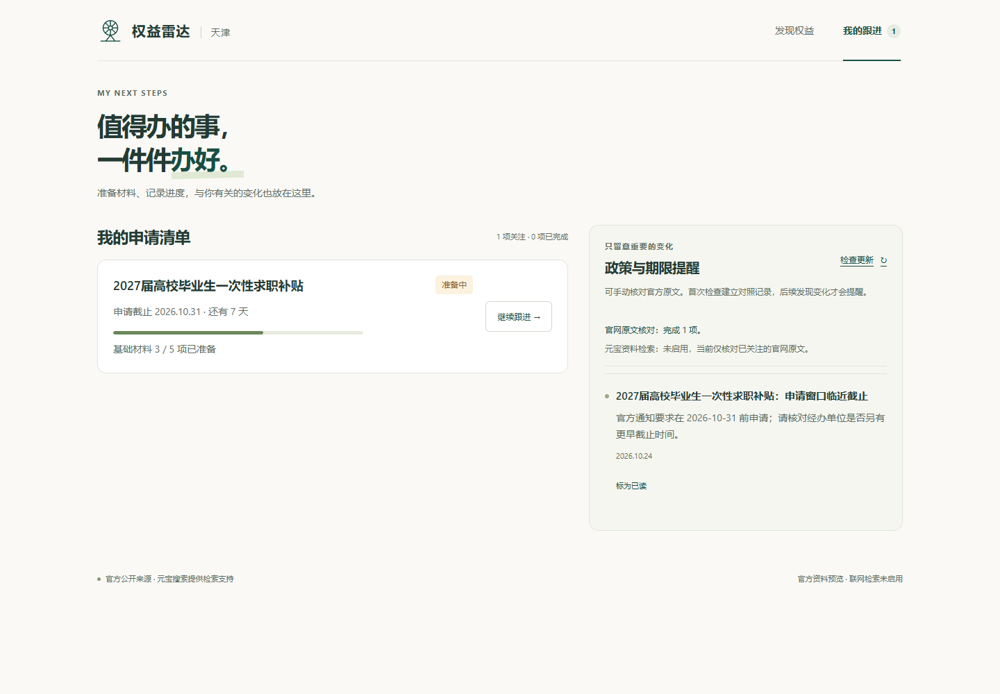
    </td>
  </tr>
</table>

<details>
<summary><strong>查看手机界面</strong></summary>
<br>
<p align="center">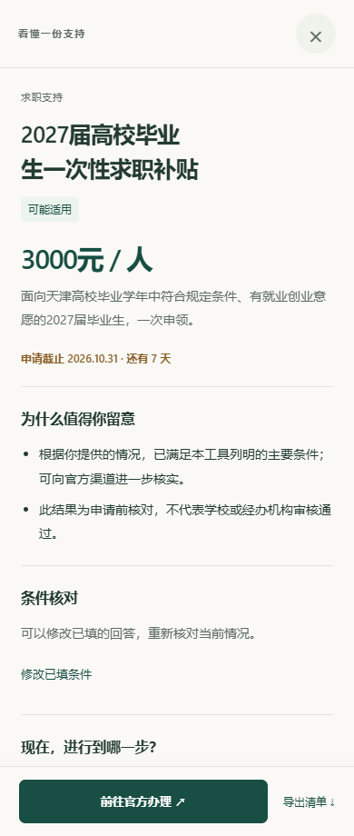</p>

手机采用单列布局，详情保留底部办理操作；选项、关闭与主要操作支持触控和键盘焦点反馈。浏览器视口验证不等同于物理手机实测。

</details>

以上业务过程图使用虚构示例情况，来自独立运行的真实本地模式，不代表任何真实个人的资格或获批结果。示例中的“可能适用”是申请前核对结果；账号模式见下方补充截图。所有截图均不作为真实元宝调用的证明。

## 快速开始

需要 **Python 3.11+**。默认本地模式使用 Python 标准库，无需安装前端框架、数据库服务或第三方运行依赖。账号模式另需安装下文的 `requirements.txt`。

```bash
git clone https://github.com/xiaosongxiaosong1111/benefit-radar.git
cd benefit-radar
```

### 本地模式

**Windows / PowerShell**

```powershell
.\start_app.ps1
```

**macOS / Linux**

```bash
python3 -B policy_server.py --port 4173
```

打开 **[http://127.0.0.1:4173/](http://127.0.0.1:4173/)**。Windows 可用 `.\start_app.ps1 -Port 4174` 更换端口。

默认未配置搜索密钥时，仍可体验官方资料预览、条件核对、材料清单、申请进度和原文检查。页面会明确标注 **“联网检索未启用”**。

> 服务始终监听本机回环地址。公网部署使用账号模式与 HTTPS 反向代理，步骤见 [部署说明](docs/DEPLOYMENT.md)。Python 后端需要运行中的进程，仓库上传到 GitHub 或启用静态页面托管不会自动启动后端。

## 账号与 API 配置

账号模式为每个人建立独立的工作区：**自己的情况、自己的清单、自己的元宝 Key。** 管理员的 Key 只用于管理员本人，普通账户未配置时不会借用管理员或服务器环境中的密钥。

<table>
  <tr>
    <td width="50%" valign="top">
      <strong>登录后，从自己的进度继续</strong><br>
      <sub>管理员初始化后开放普通账户注册。切换账号会切换整份问答、材料与提醒。</sub><br><br>
      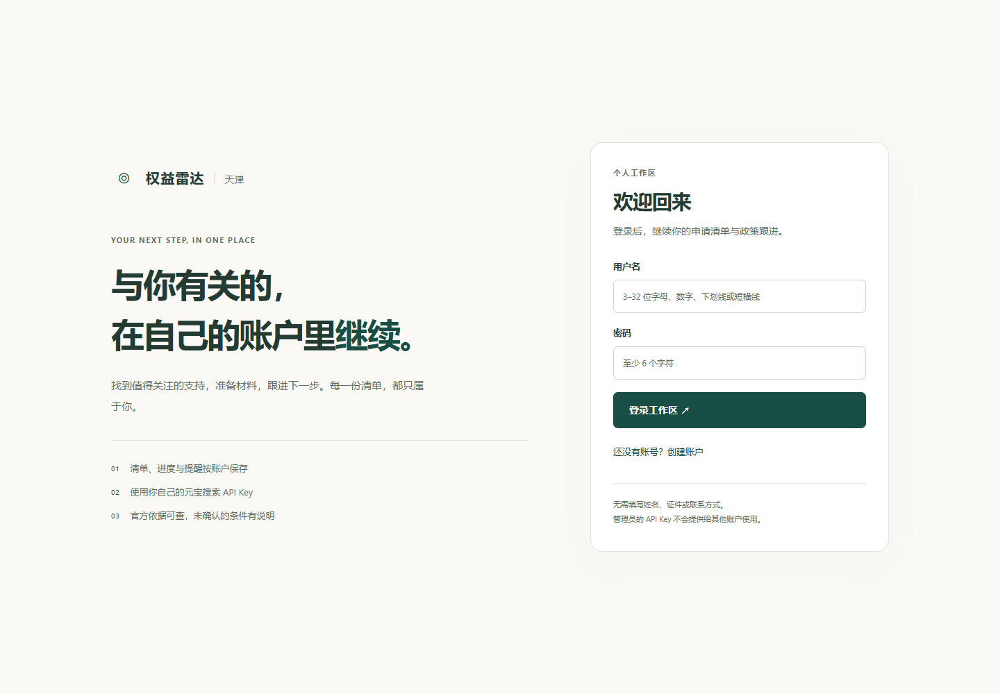
    </td>
    <td width="50%" valign="top">
      <strong>API 是否可用，看验证结果</strong><br>
      <sub>新账户默认尚未配置。密钥只显示掩码，保存与实际验证状态分别记录。</sub><br><br>
      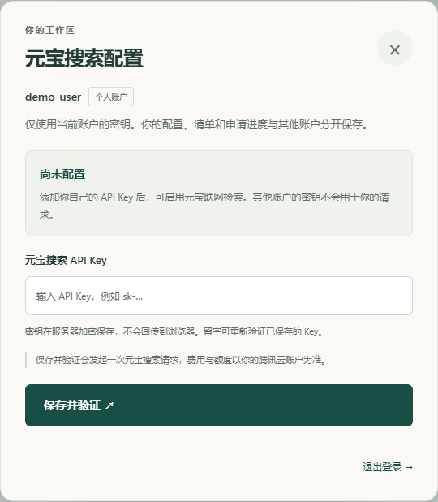
    </td>
  </tr>
</table>

注册或登录后，打开右上角的 **账户与 API 设置**，填入自己的元宝搜索 API Key，点击 **保存并验证**。保存新 Key 后会发起 **1 次实际 SearchPro 请求**；已保存 Key 时也可留空输入框，重新验证现有配置。

| 页面状态 | 表示什么 |
| --- | --- |
| 尚未配置 | 当前账户没有 Key，联网检索未启用。 |
| 已保存，等待验证 | 密钥已加密入库；仅保存成功还不能证明可以调用。 |
| API 已生效 · 上次验证可用 | 最近一次实际请求成功，并记录验证时间；后续权限或额度变化仍可能影响调用。 |
| 验证未通过 | 本次请求失败，请检查密钥、服务权限或账户额度后重试。 |

删除 Key 后，当前账户停用这份配置，后续请求不会改用其他账户的密钥。页面只回显末尾掩码；输入框在提交、关闭设置或退出账号时清空。账号模式的 API Key 通过 **Fernet 加密**保存，不写入浏览器存储，也不提供跨账号读取原文密钥的接口。

### 启动账号模式

**Windows / PowerShell**

```powershell
py -m pip install -r requirements.txt
py policy_accounts.py --data-dir data/accounts --create-admin admin
py -B policy_server.py --accounts --data-dir data/accounts --port 4173
```

**macOS / Linux**

```bash
python3 -m pip install -r requirements.txt
python3 policy_accounts.py --data-dir data/accounts --create-admin admin
python3 -B policy_server.py --accounts --data-dir data/accounts --port 4173
```

初始化管理员时会遮罩输入并确认密码，密码至少 6 位，可使用纯数字，不放在命令参数中；重复初始化已有管理员不会重置其密码。`requirements.txt` 为账号模式引入 `cryptography>=50.0.2,<51`，默认本地模式仍可独立运行。

登录会话使用 `HttpOnly`、`SameSite=Lax` Cookie，写操作校验 CSRF Token；生产部署配置 HTTPS 的 `--public-origin` 后使用 `Secure` Cookie。具体代理、进程和证书配置见 [docs/DEPLOYMENT.md](docs/DEPLOYMENT.md)。

账号资料与加密密钥元数据位于 `data/accounts/accounts.sqlite3`，个人工作数据位于 `data/accounts/users/<用户ID>/policy.sqlite3`。解密所需的 `data/accounts/master.key` 必须与数据库纳入受限备份，不能提交 Git；丢失后无法解密原先保存的 API Key。

## 元宝搜索参与在哪里

元宝搜索负责 **检索天津官方公开来源、发现相关资料线索**。资格初筛使用已整理并核验的三项政策规则；新检索结果先作为“待核对”资料，不会直接改写申请条件或认定申请资格。

<p align="center">
  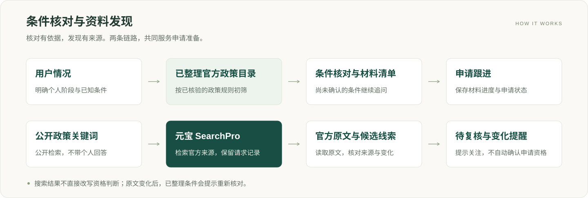
</p>

| 环节 | 当前实现 |
| --- | --- |
| 搜索输入 | 使用公开政策关键词；不把个人问答发送给搜索服务。当前查询以天津毕业生支持政策为主。 |
| 官方检索 | 调用 SearchPro，限定天津政府官方来源；重复查询使用 5 分钟缓存。 |
| 运行证据 | 界面区分实时、缓存、未配置与失败状态，展示服务返回的检索时间与 `RequestId`。 |
| 原文核对 | 对关注政策保存正文与效力标注的对照记录，变化后显示复核提醒。 |
| 新资料处理 | 按对象、条件、材料、时间和行动摘录原文；缺少依据的字段保持为空。 |
| 最终成果 | 可追溯的条件核对结果、材料清单、办理入口与申请跟进记录。 |

### 启用联网搜索

**本地模式**准备腾讯云元宝搜索服务的有效 API Key 后，在 PowerShell 中运行：

```powershell
.\start_app.ps1 -WithSearch
```

按提示输入密钥。输入内容被遮罩，只注入本次服务进程，不写入源码、浏览器或数据库。也可通过当前进程的 `TENCENTCLOUD_WSA_APIKEY` 环境变量配置。**账号模式**使用上文的账户设置页，每个账户单独保存与验证；服务器环境变量不会作为用户账户的兜底 Key。

接口实现对应 [腾讯云 SearchPro 官方文档](https://cloud.tencent.com/document/product/1806/130615)。实际授权、套餐权限和召回效果需要在你自己的账户下验证；本仓库的无密钥演示和自动化测试不代表真实 SearchPro 调用已经通过。

## 天津试点资料

以下是 **2026-10-24 的资料快照**。政策正文、受理时间与院校要求可能变化，申请前应查看最新原文并向经办机构核实。

| 事项 | 资料中的申请或效力节点 | 官方依据 |
| --- | --- | --- |
| 2027 届高校毕业生一次性求职补贴 | 通知申请节点为 2026-10-31；院校可另有具体要求 | [津人社办发〔2026〕37号](https://www.tj.gov.cn/zwgk/zfxxgkzl/fdzdgknr/zdmsxx220316/jy_157359/zcwj_157391/202610/t20261009_7390207.html) |
| 高校毕业生灵活就业社会保险补贴 | 每月 20 日为办理节点；当前依据有效至 2027-12-31 | [津人社办发〔2024〕50号](https://hrss.tj.gov.cn/zhengwugongkai/zhengcezhinan/zxwjnew/202412/t20241224_6813668.html) |
| 天津居住证首次申领 | 当前管理办法于 2026-12-31 废止，后续应核对新依据 | [津政规〔2021〕6号](https://www.tj.gov.cn/zwgk/szfwj/tjsrmzf/202112/t20211231_5768456.html) |

## 提醒、数据与运行范围

| 你关心的事 | 实际行为 |
| --- | --- |
| 提醒怎样产生 | 本地服务每 6 小时检查关注政策，也可手动检查；临近申请截止会生成站内提醒。 |
| 关闭网页之后 | 服务保持运行时仍可积累站内通知；关闭服务后停止监测。页面可见时每 60 秒同步本机状态。 |
| 原文发生变化 | 展示正文差异或效力标注，要求重新核对；维护者发布匹配当前正文且有效的复核依据后解除提示，页面重新核对本地规则，不额外发起搜索。 |
| 新资料尚未处理完 | 保留待处理记录，每轮最多读取两条新资料；失败任务排到队尾重试，服务重启后可继续处理。 |
| 回答存在哪里 | 本地模式保存在当前浏览器；账号模式保存到当前用户的服务端数据库，不混用浏览器原有的本地问答。 |
| 清单存在哪里 | 本地模式为 `data/policy.sqlite3`；账号模式为各用户独立的 `data/accounts/users/<用户ID>/policy.sqlite3`，包含关注、材料、状态、提醒与原文快照。 |
| 账户如何隔离 | 问答、跟进、材料、提醒、检索缓存与 API Key 按登录账户处理；管理员的密钥不向其他用户共享。 |
| 当前边界 | 天津试点；没有全国规则库、微信或邮件推送及代提交申请能力。默认本地模式无登录，账号模式支持注册与独立工作区。 |

基础材料准备完成与申请已提交、已获批是不同状态。已完成或取消关注的事项不再产生新提醒；来源读取失败会保留上次记录并显示失败状态。

## 验证记录

当前本机验证记录见 [QA.md](QA.md)。

| 验证层 | 已有记录 | 覆盖重点 |
| --- | ---: | --- |
| Python 单元、集成与安全回归 | 118 项运行：117 通过、1 项跳过 | 条件匹配、持久化、待处理重试、复核恢复、账号隔离、密钥加密与请求校验；Windows 跳过 POSIX 权限检查 |
| 前端纯逻辑 | 65 项通过 | 下一步任务、状态优先级、材料分组、准备进度、导出与政策阅读顺序 |
| Chrome 本地模式流程 | 127 项断言通过 | 下一步定位、复核恢复、本地重算不搜索、填写、纠错、保存、异常恢复、键盘焦点与响应式布局 |
| Chrome 账号模式流程 | 109 项断言通过 | 六位数字及前导零密码登录、用户数据隔离、账号切换、密钥状态、掩码回显与验证交互 |

Python 全部 8 个业务模块当前测得合并语句与分支覆盖率 **90%**。浏览器合计 **236 项断言通过**，覆盖 320、360、390、768、1024 和 1440 像素宽度；自动化使用随机端口和临时 SQLite，并从测试子进程环境中剔除搜索密钥，不修改实际用户清单。账号验证交互使用明确的受控提供方，不代表真实元宝账户授权或额度已验证。

<details>
<summary><strong>开发验证命令与目录</strong></summary>

测试依赖与生产运行分开。在 Windows / PowerShell 中：

```powershell
py -m pip install -r requirements.txt -r requirements-dev.txt
py -B -m coverage run --branch --source=policy_core,policy_catalog,policy_service,policy_server,policy_sources,policy_accounts,policy_tenants,policy_auth_http -m unittest discover -s tests -p "test_*.py" -v
py -m coverage report --fail-under=80
node tests/test_frontend_model.cjs
```

浏览器回归另需 Node.js、Playwright 与可用浏览器：

```powershell
node tests/e2e.cjs
node tests/accounts.e2e.cjs
```

可用 `PLAYWRIGHT_MODULE` 指向现有 Playwright 模块目录，或用 `CHROME_PATH` 指定 Chrome 可执行文件。Windows 默认使用标准安装路径的 Chrome；其他平台需准备 Playwright 可用的 Chromium。

```text
benefit-radar/
├── policy_catalog.py     # 官方资料目录与申请规则
├── policy_core.py        # 来源校验、指纹与提醒规则
├── policy_sources.py     # SearchPro、官方正文提取与原文摘录
├── policy_service.py     # SQLite、监测、搜索缓存与站内提醒
├── policy_server.py      # 本机 HTTP API 与静态资源
├── policy_accounts.py    # 账户、会话、Fernet 密钥存储与管理员初始化
├── policy_auth_http.py   # 登录、CSRF 与 API Key 设置接口
├── policy_tenants.py     # 每用户服务、独立数据与监测
├── static/               # HTML / CSS / JavaScript 交互界面
├── tests/                # 单元、集成与浏览器流程验证
├── docs/                 # README 视觉资产与运行截图
│   └── DEPLOYMENT.md      # HTTPS 账号模式部署与备份说明
├── start_app.ps1         # Windows 启动与遮罩密钥输入
└── QA.md                 # 验证记录与尚未验证项
```

</details>

---

<p align="center">
  <strong>与你有关的，替你留意着。</strong><br>
  <sub>依据来自官方，核对留在眼前，下一步由你决定。</sub>
</p>

本项目开发使用 AI 辅助。工具提供申请前核对和准备支持，最终解释、受理和资格审核以官方经办机构及最新通知为准。
